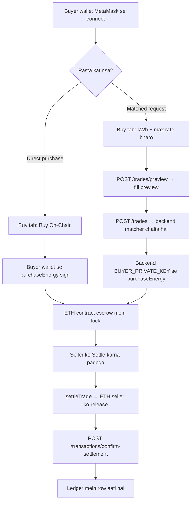
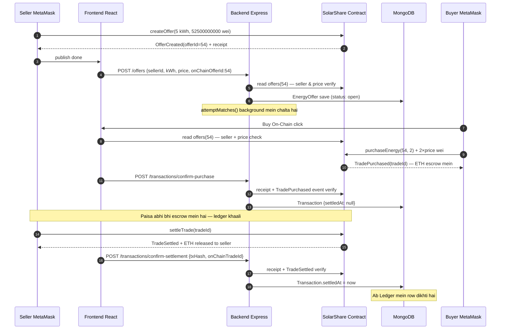
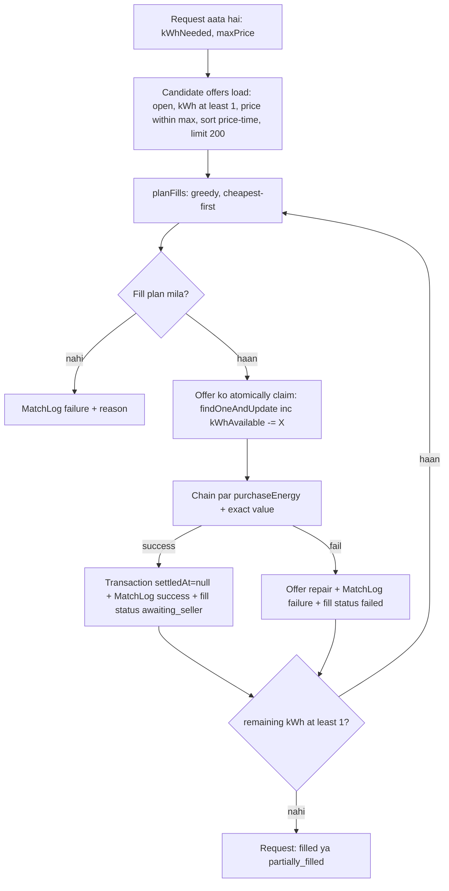
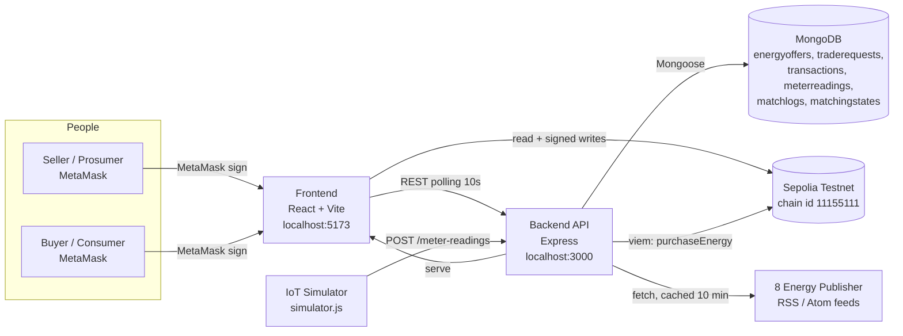

# ☀️ SolarShare — Complete Project Guide (Hinglish)

> **Ek line mein:** SolarShare ek blockchain-powered peer-to-peer (P2P) solar energy trading platform hai, jahan rooftop solar wale log apni **extra (surplus) bijli** seedha apne neighbourhood ke buyers ko offer kar sakte hain — matching backend karta hai, aur **paise ka settlement seller ke apne MetaMask wallet se on-chain hota hai.**

Ye README **actual codebase ko padh kar** likha gaya hai. Isme sirf wahi features describe kiye gaye hain jo really implemented hain. Jahan kuch partial ya planned hai, wahan clearly likha hai.

**Repo:** `D:\solarshare` · **Branch:** `ui/seller-buyer-journeys`
**Network:** Sepolia testnet (chain ID `11155111`)
**Contract:** [`0xd5332E490e251813702bf461CAfED84FF3d0319C`](https://sepolia.etherscan.io/address/0xd5332E490e251813702bf461CAfED84FF3d0319C)
**Data note:** Ye README 15 Oct 2026 ko code verification ke baad likha gaya. Tariff dataset bhi 15 Oct 2026 ko review hua tha.

---

## 0. Judge Ke Saamne Pehle 30 Second — Ye Bolo

> "Sir/Ma'am, SolarShare ek peer-to-peer solar energy trading marketplace hai.
> Aaj India mein rooftop solar lagane wale ghar mein **extra bijli bach jaati hai**, aur wahi waqt paas ke ghar ko **mehngi grid bijli** chahiye hoti hai — par dono ek doosre ko dhoondh nahi paate, aur payment ka koi trustworthy record nahi hota.
> SolarShare mein seller apna surplus **on-chain offer** banata hai, backend ka **price-time matcher** buyer ki request ko sabse saste offers se match karta hai, buyer ka paisa **smart-contract escrow** mein chala jaata hai, aur paisa seller ko tab milta hai jab **seller khud apne MetaMask wallet se `settleTrade` sign karta hai**.
> Har offer, har purchase aur har settlement ka **transaction hash Sepolia Etherscan par verifiable** hai. Saath mein humne ek **energy news feed** aur ek **verified tariff reference + price comparison calculator** bhi banaya hai."

**Isme kya claim nahi kar rahe (important, judges ise appreciate karte hain):**
- Ye ek **academic/demo prototype** hai — production ya legally-approved electricity trading system nahi.
- Ye DISCOM (distribution company) ko **replace nahi karta**. Ye uske upar ek *local marketplace layer* ka proof-of-concept hai.
- Koi regulatory licence, net-metering integration ya real money settlement **nahi** hai. Sab kuch Sepolia **test ETH** par chalta hai.

---

## 1. Project Introduction

### 1.1 Project kya hai

SolarShare = **IoT simulation + Matching engine + Blockchain settlement + Web dashboard**, chaar layers ek saath.

| Layer | Kya karta hai | Folder |
|---|---|---|
| IoT simulation | Synthetic meter readings (generation/consumption) generate karke backend ko bhejta hai | `iot-simulator/` |
| Mating engine | Price-time priority se off-chain offers aur requests ko match karta hai | `backend/src/services/` |
| Blockchain settlement | Solidity contract Sepolia par offers, purchases aur settlements record karta hai | `contracts/` |
| Web marketplace | React dashboard + Express API + MongoDB | `frontend/`, `backend/` |

### 1.2 Tagline

> **"Clean energy, shared with your neighbours."**
> (Dashboard ka hero heading — asli UI mein yahi likha hai.)

### 1.3 Problem it solves (short)

Rooftop solar se surplus bijli paas ke consumer tak pahunchane ke liye teen cheezein chahiye: **buyer discovery**, **transparent price** aur **trustworthy transaction record**. Aaj ye teeno ad-hoc hain. SolarShare ek open marketplace banata hai jahan discovery matcher karta hai, price publicly visible hota hai, aur record blockchain par immutable hota hai.

### 1.4 Proposed solution

1. Seller apna surplus **`createOffer`** se on-chain list karta hai.
2. Buyer ya to **matched request** bhejta hai (backend price-time matcher chalta hai) ya kisi listing ko **directly on-chain kharid** leta hai.
3. Buyer ka payment **contract escrow** mein lock ho jaata hai (turant seller ko nahi jaata).
4. **Seller khud `settleTrade` sign karta hai**, tab escrow release hota hai aur ledger row banti hai.

### 1.5 Target users

| User | Kaun hai | Kya chahta hai |
|---|---|---|
| **Prosumer (seller)** | Rooftop solar laga ghar/apartment | Extra units ka better rate + income record |
| **Consumer (buyer)** | Paas ka ghar / small shop / EV owner | Grid se sasti bijli + green energy proof |
| **Evaluator (judge/faculty)** | Reviewer | Evidence, architecture, honesty, working demo |

### 1.6 Conventional electricity market se different kaise

| Normal arrangement | SolarShare (prototype) |
|---|---|
| DISCOM tariff fixed hota hai, consumer ke paas choice nahi | Buyer seller ka **published rate** dekh kar choose karta hai |
| Records DISCOM ke billing system mein | Har step ka **on-chain transaction hash** publicly verifiable |
| Paisa pehle jaata hai, record baad mein | Paisa **escrow** mein rukta hai; seller sign kare tab release |
| Discovery — koi mechanism nahi | **Price-time matching engine** automatically cheapest offer pehle uthata hai |
| Matching/procurement invisible | Matching **deterministic & reproducible** hai (unit tests se covered) |

### 1.7 30-second pitch (script form)

> "Aaj surplus rooftop solar grid ko de diya jaata hai jahan uska value kam milta hai, aur paas ke consumer ko retail tarif pe mehngi bijli milti hai. Beech mein trust nahi hota. SolarShare ek local marketplace banata hai: seller on-chain offer karta hai, matcher buyer ko sabse saste offers se match karta hai, payment smart-contract escrow mein jaata hai, aur paid out sirf seller ke apne wallet se settlement ke baad hota hai. Sab kuch Sepolia par verifiable hai — hum Etherscan link dikha sakte hain."

---

## 2. Problem Statement

### 2.1 Industry ke real problems (general)

| # | Problem | Detail |
|---|---|---|
| 1 | **Surplus ka misuse** | Rooftop solar din mein paisa-generate karta hai jab ghar pe load kam hota hai. Extra units net-metering/feed-in par chale jaate hain jahan return kam hota hai. |
| 2 | **Buyer discovery nahi** | Ek neighbour ko sasti green bijli chahiye, par usko pata hi nahi ki paas mein kaun surplus bech raha hai. |
| 3 | **Price transparency nahi** | P2P market mein "right price" ka koi public reference nahi. |
| 4 | **Trust & record** | Kaun kisko kitna diya, kaunse rate pe — kaagaz/hisaab ad-hoc. |
| 5 | **Payment risk** | Buyer ko dar hai ki paisa de diya par units aa gayi ya nahi; seller ko dar hai ki units de di par paisa aayega ya nahi. |
| 6 | **Verification** | Audit ke liye ek tamper-proof record chahiye hota hai. |

### 2.2 Jo problems ye app **actually solve karta hai** (implemented)

| # | Solved | Kaise (code se verified) |
|---|---|---|
| A | Buyer discovery | `Market` tab har open offer list karta hai; matcher price-time priority se match karta hai |
| B | Price transparency | Har listing ka rate visible; Dashboard par lowest/highest/average listed rate |
| C | Payment safety | `purchaseEnergy` payable → ETH **contract escrow** mein; release sirf `settleTrade` se |
| D | Seller authorisation | Settlement **sirf seller ka apna wallet** sign kar sakta hai (contract `NotSeller` revert) |
| E | Tamper-proof record | `OfferCreated` / `TradePurchased` / `TradeSettled` events + har row par Etherscan tx link |
| F | Ledger honesty | Ledger mein row sirf tab aati hai jab backend **on-chain receipt verify** kar leta hai (`settledAt` set) |
| G | Consumer price context | `Tariffs` tab mein verified DISCOM tariff + P2P rate comparison calculator |

### 2.3 Jo problems ye **solve nahi karta** (honest disclosure)

- DISCOM licensing, grid integration, net-metering ya metering authority approval.
- Real fiat money settlement (test ETH only).
- Physical energy delivery guarantee — ye ek *trading & settlement* prototype hai.
- Automated settlement on the seller's behalf (by design — privacy/custody ke liye nahi kiya).

---

## 3. Our Solution — Feature by Feature

### 3.1 Seller (Prosumer) side

- **Publish on-chain offer:** seller MetaMask se `createOffer(kWh, pricePerKWh)` sign karta hai. **Offer tabhi marketplace mein aata hai jab on-chain receipt confirm ho** (frontend `waitForTransactionReceipt` → phir `POST /offers`).
- **My offers table:** har listing ka kWh left, rate, status, on-chain tag (`On-chain #ID` ya `Off-chain (MongoDB)`), aur create-offer tx link.
- **Incoming purchases:** jo purchases escrow mein band hain, wo alag dikhte hain — **Settle** button ke saath.
- **Earnings history:** sirf settled sales, released amount ke saath (`Total released from escrow`).

**Value:** seller ko pata rehta hai kitna paisa escrow mein atka hai aur kitna release ho chuka hai. "Sold out" ka matlab sirf ye hai ki quantity khatam hai — **paisa release hona nahi**.

### 3.2 Buyer (Consumer) side

- **Matched request:** buyer `kWh needed` aur `max ₹/kWh` deta hai. **Fill preview backend se aata hai** (`POST /trades/preview`) — *wahi engine* jo submit par chalega, yaani preview jhooth nahi bol sakta.
- **Direct purchase:** kisi bhi open listing par **Buy On-Chain** — buyer khud MetaMask se `purchaseEnergy` sign karta hai.
- **Order progress:** har fill ka timeline — `Matched → Purchased → Settled`, purchase/settlement tx links ke saath.
- **Purchase history:** direct purchases aur unka settled/pending status.

**Value:** buyer ko pehle hi dikh jaata hai kaunsa seller, kitna kWh, kaunse rate pe match hoga aur kitna ETH escrow lagega.

### 3.3 Matching (backend)

Deterministic **price-time priority**: sabse sasta offer pehle; same price par jo **pehle** create hua wo pehle; tie ho to id se. Poora logic ek pure module (`matchingEngine.js`) mein hai — isliye **unit-testable** hai (11 tests).

### 3.4 Blockchain settlement

- `purchaseEnergy` ETH ko **escrow** mein rakhta hai (buyer ke wallet se).
- `settleTrade` **sirf seller** call kar sakta hai; wahi ETH seller ko transfer karta hai.
- Ledger row sirf **verified `TradeSettled` receipt** ke baad.

### 3.5 News & Tariff features (bonus, isolated)

- **Energy News:** backend 8 publisher RSS/Atom feeds se sirf **energy-market relevant** headlines laata hai (solar, renewables, markets, storage, grid, P2P trading), IST times ke saath, today first.
- **Tariff & Price Comparison:** 21 DISCOM providers ki directory + **sirf official regulator documents se transcribe kiye gaye** tariff slabs + ek calculator jo grid variable charge aur SolarShare rate compare karta hai.

---

## 4. Technology Stack

| Layer | Technology | Version (verified) | SolarShare mein actual role |
|---|---|---|---|
| Frontend | **React** | 19.x | Saare pages, tab, form aur live state UI |
| Frontend build | **Vite** | 6.x | Dev server (`:5173`) + production build |
| Frontend routing | **react-router-dom** | 7.x | 7 routes (`/`, `/market`, `/sell`, `/buy`, `/ledger`, `/tariffs`, `/news`) |
| Frontend chain reads | **viem** | 2.56.x | Contract reads + MetaMask writes, gas estimation, event decoding |
| Backend | **Node.js + Express** | Express 5.x | REST API + server-side matching |
| Database | **MongoDB + Mongoose** | Mongoose 8.x | Offers, requests, transactions, readings, match logs |
| Blockchain client | **viem** | 2.21.x | Backend side `purchaseEnergy` / verification |
| Smart contract | **Solidity** | `^0.8.28` | Offers, escrow, settlement rules |
| Contract tooling | **Hardhat 3 + Ignition + Viem toolbox** | hardhat 3.x | Compile, test (`hardhat test nodejs`), deploy to Sepolia |
| Wallet | **MetaMask** | browser extension | User ki identity + transaction signing |
| Chain | **Sepolia testnet** | chain ID `11155111` | Sab offers/purchases/settlements on-chain |
| External data | **8 publisher RSS/Atom feeds** | keyless | Energy news (`GET /news`) |
| IoT data source | **Node "sun simulation"** | plain JS | Meter readings (`POST /meter-readings`) |

### 4.1 Technology choices kyun (Hinglish)

- **Solidity + smart contract:** escrow ka logic trust ko code mein le jaata hai. "Paisa seller ko tabhi jaayega jab seller sign kare" — ye rule contract mein hard-coded hai, kisi server ke bharose nahi.
- **Viem (ethers.js nahi):** modern, tree-shakeable, aur Sab ke types clean. `estimateContractGas` aur `decodeEventLog` bilkul wahi deta hai jo humein chahiye.
- **Express + MongoDB:** matching off-chain rakha — kyunki har candidate comparison on-chain karna mehnga aur slow hota. Mongo mein fast queries (`{status, pricePerKWh, createdAt}` compound index), chain par sirf final money movement.
- **REST polling (WebSocket nahi):** simple aur demo-safe. Frontend har **10 second** par data refresh karta hai.
- **RSS feeds (paid news API nahi):** news feature ko **API key ki zaroorat nahi**, aur `GET /news` MongoDB ke bina bhi chalta hai.
- **IoT simulator:** real solar meter hardware ke bina bhi realistic PV/demand curve se end-to-end data-flow demonstrate ho jaata hai.

---

## 5. Application Navigation — Har Tab Ka Detailed Guide

### 5.0 Layout: Top Bar + Status Bar + Footer

**Header (har page par):**

| Element | Kya dikhata hai | Click par |
|---|---|---|
| **Logo (emblem + "SolarShare" wordmark)** | Brand + "P2P solar microgrid" | `/` (Dashboard) |
| **Nav links** | `Dashboard · Market · Sell · Buy · Ledger · Tariffs · News` | Us route par navigate |
| **Wallet chip** | `Connect wallet` **ya** `Wallet · 0x1234…5678` + `Sepolia · 1.2345 ETH` | MetaMask connect karta hai |
| **☰ Menu / ✕ Close** | Mobile par nav (≤1080px) | Nav panel kholta/band karta hai |

**Status bar (header ke neeche):** live chain health.

- `Network Sepolia` (green dot) — ya `Wrong network · <id>`
- `RPC OK` — ya `unavailable`
- `Contract 0xd533… deployed` — contract bytecode chain par mila, ya `unavailable` / `not configured`
- Agar network Sepolia nahi hai to ek **"Switch to Sepolia"** button (MetaMask se `wallet_switchEthereumChain`).

**Footer:** logo + `Sepolia energy trading prototype · Settlements confirmed on-chain only` + contract address + **View on Etherscan** link.

**Background timers (har page par chalte hain):**

| Timer | Interval | Kya karta hai |
|---|---|---|
| `refresh()` | **10 sec** | `GET /offers`, `/trades`, `/transactions`, `/meter-readings`, `/metrics` |
| Chain probe | **30 sec** | chain id, block number, contract code check |
| News sync | **5 min** | `GET /news` (sirf News page) |

---

### 5.1 🏠 Dashboard — `/`

**Kaam:** poore marketplace ka snapshot. Ye "landing page + analytics" hai.

**Display hota hai:**

1. **Hero:** heading *"Clean energy, shared with your neighbours."* + 3 buttons → **Sell energy**, **Buy energy**, **Browse market**.
2. **4 headline KPIs:**

| Card | Kya dikhata hai |
|---|---|
| Energy available | Open offers ka total kWh + `from ₹X/kWh` (lowest) |
| Active requests | `open` + `partially_filled` buyer requests count |
| Awaiting settlement | Escrow mein pade purchases (seller ne settle nahi kiya) |
| Settled trades | Confirmed settlements + on-chain delivered kWh |

3. **4 analytics cards:** Settled value (₹, avg ₹/kWh) · **Buyer savings vs baseline** · **Matching success rate** · **Offer → settlement** latency.
4. **Marketplace activity chart:** last 7 din ka grouped bar chart — *Offers created / Requests created / Settlements confirmed*.
5. **Open market snapshot:** lowest, highest, average listed rate + total supply.
6. **Generation vs consumption (today):** meter readings ka hourly stacked chart (solar generation ek colour, household consumption doosra).
7. **Latest settlements table (top 5):** Settled time (IST) · Seller · Buyer · Energy · Value · Purchase + Settlement tx links.
8. **"How it works" strip:** `01 Publish supply → 02 Match & escrow → 03 Seller settles`.
9. **Observed on-chain gas note** (agar metrics available ho): `Purchase ≈ X ETH · Settlement ≈ Y ETH`, live quoted — kabhi hard-coded nahi.
10. Agar wallet connected nahi hai to ek **role banner**: *"Connect MetaMask to buy, sell, or settle trades with your own wallet."*

**Kya kar sakte ho:** Sell/Buy/Market par jump karo, kisi bhi settlement tx ko Etherscan par kholo.

---

### 5.2 🛒 Market — `/market`

**Kaam:** matcher ko jo listings dikhti hain, wahi yahan public list mein dikhti hain. Default **cheapest first**.

**4 KPI cards:** Open offers (+ kitne on-chain backed hain) · Available supply (kWh) · Lowest rate · Average rate.

**Panel "Available supply" ke controls:**

| Control | Options |
|---|---|
| Search | seller address se search |
| Offer scope | `All` / `Mine` |
| Sort | `Price ↑` (default) · `Price ↓` · `kWh ↓` · `Newest` |

**Table columns:** Seller (agar aapki hai to `Your offer` badge) · Available · Rate · **Listing source** (`On-chain #ID` / `Off-chain (MongoDB)`) · Published (relative time) · Status.

**Important note jo page par likha hai:** *"Offers marked On-chain have a contract offer ID and can be purchased or matched directly. Offers marked Off-chain exist only in MongoDB and cannot be settled until they are published to the contract."*

**Empty states:** search filter ke liye *"No offers match this view"* (with "Clear the search…"), warna *"The market is quiet"* + **Go to Sell** button.

**Kya kar sakte ho:** browse, filter, apni listings identify karo, aur (Buy page se) kharido.

---

### 5.3 ☀️ Sell — `/sell` (Seller workspace)

**Kaam:** seller ka poora control room.

**Top:** role banner (agar wallet registered Prosumer/Both nahi hai to **"Register as Prosumer on Sepolia"** button).

**4 KPI cards:** Today's generation (kWh, + consumption) · Available surplus (kWh) · Open offers · **Total earned** (settled only).

**Panel "Sell your solar surplus" — the offer form:**

| Field | Type | Rule |
|---|---|---|
| Available energy | number | **whole kWh** (₹5.5 allow nahi — integer) |
| Marketplace rate | number | ₹ per kWh (> 0) |

- **Contract rate preview:** form ke andar live dikhata hai ki rate contract mein kaise jaayega, e.g. `52500000000 wei / kWh (0.0000000525 ETH / kWh)` — yaani **₹ ko 10 decimal places** wale integer wei mein convert karte hain.
- **Submit button:** `Publish on Sepolia`.
- **Step progress:** `Confirm in wallet → Creating on-chain → Registering → Live`.

**Publish karne par exactly kya hota hai (code se verified):**

```
1. wallet check  →  MetaMask se ensureSepoliaNetwork()
2. validation    →  whole kWh >= 1, price > 0
3. ensureProsumer() → agar role registered nahi, to registerParticipant(1) sign karna padta hai
4. createOffer(kWh, priceWei)  ← SELLER KA METAMASK SIGN KARTA HAI
5. waitForTransactionReceipt() → status === "success" hona chahiye
6. decodeContractEvent(receipt, "OfferCreated") → offerId nikalta hai
7. POST /offers { sellerId, kWhAvailable, pricePerKWh, onChainOfferId }
   → backend chain se verify karta hai (seller + price), phir MongoDB mein save
8. onRefresh() → table live ho jaata hai
```

Agar step 5 ya 6 fail ho jaaye, to **MongoDB mein entry save hi nahi hoti** — isliye marketplace aur chain kabhi diverge nahi karte (ek direction mein).

**Panel "Meter data":** aaj ke readings ka hourly chart (sirf tab jab reading ka `userId` aapke wallet address se match kare).

**Panel "My offers":** kWh left · Rate · Status · Listing source · Offer transaction (create tx link ya contract link).
Page par likha hai: *"Sold out" means no kWh remain to buy; it does not mean the buyer's escrow has been released.*

**Panel "Awaiting seller settlement" (incoming purchases):** header badge par `N trades · ₹X escrowed`, har row par buyer, trade id, purchase tx link aur **`Settle` button**.

**Panel "Earnings history":** Confirmed settlements · Energy delivered · **Total released from escrow** + settled sales table.

---

### 5.4 ⚡ Buy — `/buy` (Buyer workspace)

**Kaam:** buyer ke do raste — matched request aur direct purchase.

**4 KPI cards:** Open requests · In escrow (count + ₹ amount) · Settled energy bought (kWh + ₹ spent) · Average settled rate.

**Panel 1 — "Request energy" (matched flow):**

| Field | Type |
|---|---|
| Energy needed | number, **whole kWh** |
| Maximum rate | ₹ per kWh |

- **Fill preview (automatic):** type karte hi 300ms debounce ke baad `POST /trades/preview` call hota hai. Preview mein: har fill ka seller + `kWh @ ₹rate`, **Average matched rate**, **Matched value**, aur **Contract escrow: X ETH**.
  Page par saaf likha hai: *"The fill preview is produced by the matcher itself — the same price-time engine that runs when you submit."*
- Agar poori quantity match na ho: *"Only X of Y kWh can be matched right now."*
- **Submit button:** `Submit matched request` → `POST /trades`.

> ⚠️ **Zaroori limitation (demo mein batao):** matched request flow mein backend **platform buyer wallet** (`BUYER_PRIVATE_KEY`) se on-chain purchase karta hai. Isliye `buyerId` wahi wallet hona chahiye, warna backend `403` deta hai: *"buyerId must match the wallet controlled by BUYER_PRIVATE_KEY"*. Isliye demo ke liye **direct purchase** zyada easy hai.

**Panel 2 — "On-chain offers" (direct flow):** aapke alawa sab open offers, har ek par **`Buy On-Chain`** button (agar offer on-chain nahi hai to button disabled + label `Off-chain`).

**`Buy On-Chain` dabane par (verified sequence):**

```
1. on-chain offer id + seller address valid?
2. ensureSepoliaNetwork()
3. chain se offers(offerId) padho
4. seller address match check  → mismatch = error (kuch save nahi hota)
5. kWh = min(marketplace kWh, on-chain kWh)   [whole kWh]
6. price check: chainOffer.pricePerKWh === priceToWei(listing price)  → warna refresh bolta hai
7. ensureConsumer(wallet)  → zarurat pade to registerParticipant(2)
8. purchaseEnergy(offerId, kWh) + value = kWh × priceWei   ← BUYER KA METAMASK SIGN KARTA HAI
9. waitForTransactionReceipt → decodeContractEvent("TradePurchased")
10. POST /transactions/confirm-purchase { offerId, buyerId, purchaseTxHash }
    → backend chain se verify karta hai, escrow record banata hai (settledAt = null)
```

**Panel 3 — "Requests and fills":** har request ke saath fills ka timeline `Matched → Purchased → Settled`, aur purchase/settlement tx links. Status `purchased` ka matlab hai **paisa escrow mein hai**, `settled` ka matlab **chain par release ho gaya**.

**Panel 4 — "Purchase history":** sirf direct purchases (seller, energy, value, status, tx links).

---

### 5.5 📒 Ledger — `/ledger`

**Kaam:** public record of **settled** energy trades.

**4 KPI cards:** Settled trades · Energy settled (kWh) · Value transferred (₹ + avg ₹/kWh) · **Still pending** (escrowed, ledger se excluded).

**Controls:** Search (tx hash ya address) · Scope filter `All trades` / `My trades`.

**Table columns:** Settled (IST) · Seller · Buyer · Energy · Value · **Transactions** (Purchase + Settlement tx links, copy button ke saath).

**Page ka note (judges ke liye bahut important):**
> *"Pending activity is excluded on purpose. Escrowed purchases and matched-but-unsettled trades are not ledger entries — a successful `purchaseEnergy()` alone is not a settlement."*

**Kya kar sakte ho:** search, apni trades filter, koi bhi tx Etherscan par verify.

---

### 5.6 🧾 Tariffs — `/tariffs`

**Kaam:** DISCOM tariff reference + grid-vs-SolarShare comparison calculator. Ye feature **completely isolated** hai (frontend-only, koi API call nahi).

Teen panels hain:

**Panel A — "Price comparison" (calculator):**

- Utility (dropdown, sirf jinki tariff verified hai)
- Monthly consumption (kWh) — default `300`
- SolarShare rate (₹/kWh) — **open offers se auto-prefill** hota hai (average). Agar market khaali hai to *"No open offers are listed right now — enter a rate to compare."*
- Output: **Grid variable charge** (₹/kWh + month ka total), **SolarShare cost**, aur verdict — *"Saving X"* ya *"Paying X more than the grid at this rate"* + ek bar chart.
- **Calculation:** slab-wise (telescopic) — pehle slab ka rate pehle slab ki units par, aage ka rate aage ki units par. Sirf **energy + wheeling (variable) charge** compare hota hai. **Fixed charges, electricity duty, FAC aur taxes excluded** hain (notes mein likha hai) — kyunki wo sab units mix karte hain aur galat comparison dete.

**Panel B — "Distribution utilities" (directory):**

- **21 DISCOM/utility providers, 9 states** (Maharashtra, Delhi, Karnataka, Kerala, Gujarat, Telangana, Andhra Pradesh, Odisha, Bihar).
- Filters: search (naam/state) · state dropdown · `All` / `Verified tariff`.
- Table columns: Utility (+ full name & sector) · State · Regulator · Residential tariff (`Verified from order · FY 2026-27` **ya** `Not available`) · Official site · Action.
- Action: verified tariff ke liye **Compare**, baaki ke liye **Details** (jo sirf reference panel update karta hai).

**Panel C — "Tariff reference":**

- Selected utility ka category, tariff period (effective from/to), regulator, **order citation**, slab table (Consumption band · Energy charge · Wheeling charge · Variable charge · Fixed charge), exclusions notes, aur **official source link**.

**Tariff data ka source & verification status (full detail Section 15 mein):**

| Schedule | Regulator | Source document |
|---|---|---|
| Adani Electricity Mumbai FY2026-27 | MERC | MYT Order, Case No. 211 of 2024, Annexure 3 |
| Tata Power Mumbai FY2026-27 | MERC | MYT Order, Case No. 210 of 2024, Annexure 3 |
| BESCOM FY2026-27 | KERC | KERC order dated 27 Mar 2025, LT-1 Domestic |
| Odisha (4 DISCOMs) FY2025-26 | OERC | Common order dated 24 Mar 2025 |

**Baaki utilities par tariff `Not available` hai** — kyunki unke order documents ek extraction tool se reliably nahi padhe ja sake (columns ambiguous / scanned images / site 403). **Humne guess nahi kiya.**

---

### 5.7 📰 News — `/news`

**Kaam:** live energy-industry headlines + platform activity.

**Toolbar:** `Updated at <IST>` (ya stale hone par *"Live refresh failed. Showing the last successful update from …"*), `N of M sources unavailable` badge, aur **Refresh** button.

**Category filter:** `All (N)` + per-category counts (Solar / Renewable / Markets / Policy / Storage / Grid / Trading / Climate).

**Feed:** do groups —
- **Today** (IST aaj ke articles)
- **Earlier · previous 48 hours** (agar aaj ka count kam hai) — aur ek callout: *"Only N energy stories have been published today, so relevant headlines from the previous 48 hours are included below with their original publication times."*

**Card:** thumbnail (fail hone par chup-chaap hide ho jaata hai) · category tag · source · headline (link) · summary · IST time + relative age + `Read article ↗`.

**Footer:** jo sources OK thi unke naam, aur jo nahi thi wo `unavailable:` ke saath.

**Neeche do panels:** `Marketplace activity` (live feed: offer listed / request / match / settlement, tx links ke saath) aur `SolarShare bulletin` (3 static announcements).

**Empty/error states:** koi article nahi → *"No new energy-related news available right now"* + **Check again**; feed fail → error panel + **Retry**; category khaali → *"No headlines in <category> right now"* + **Show all news**.

**8 sources:** PV Tech · pv magazine · Energy-Storage.news · Mercom India · ET EnergyWorld · Utility Dive · RenewEconomy · CleanTechnica.

---

### 5.8 404 — koi bhi galat route

`PageIntro` "Page not found" + **Back to dashboard** button.

---

## 6. Buyer Journey — Step by Step



**Buyer ke liye 6 practical steps:**

1. MetaMask connect karo (wallet chip par click). **Sepolia** network select karo. Sepolia test ETH hona chahiye.
2. `Buy` tab kholo.
3. **Direct purchase:** `On-chain offers` panel se koi offer chuno → **Buy On-Chain** → MetaMask mein confirm. (Pehli baar `registerParticipant(2)` bhi sign karna pad sakta hai.)
4. Ya **Matched request:** kWh + max rate bharo → preview dekho → **Submit matched request**.
5. Escrow hone ke baad bhi ledger **khaali rahega** — ye jaan-boojh kar hai. `Buy` page ke "Requests and fills" mein timeline `Purchased` par dikhega.
6. Jab seller settle kar de, tab `Ledger` mein row aa jaayegi aur **value transferred** badh jaayegi.

---

## 7. Seller Journey — Step by Step

1. MetaMask connect karo (Sepolia).
2. `Sell` tab kholo. Agar role registered nahi hai to banner se **Register as Prosumer on Sepolia** dabao (contract `registerParticipant(1)` sign hoga).
3. Form bharo — **Available energy: whole kWh** (e.g. `5`), **Rate: ₹/kWh** (e.g. `5.25`). Contract preview mein wei value check karo.
4. **Publish on Sepolia** → MetaMask mein `createOffer` confirm karo.
5. Step progress `Confirm in wallet → Creating on-chain → Registering → Live` complete hone par offer `Market` par live ho jaayega.
6. Buyer jab purchase karega, `Sell` tab ke **Incoming purchases** panel mein trade aa jaayegi (`N trades · ₹X escrowed`).
7. **`Settle` button** dabao → MetaMask `settleTrade` confirm karo → ETH release + ledger entry.

> **Rule:** Ye settle button **background me backend se kabhi auto-trigger nahi hota**. Backend `settleTrade` call nahi karta, sirf receipt verify karta hai. Kyunki paisa release karna seller ka decision hai.
> *(Note: `contractService.js` mein ek `settleMatchOnChain()` helper maujood hai, par wo **kisi bhi route se call nahi hota** — koi automated settlement path active nahi hai.)*

---

## 8. Smart Contract — `SolarShare.sol`

**Solidity** `^0.8.28` · File: `contracts/contracts/SolarShare.sol` · **Deployed:** Sepolia `0xd5332E490e251813702bf461CAfED84FF3d0319C` (Ignition module `SolarShareModule`)

### 8.1 Roles (integer)

| Value | Role | Matlab |
|---|---|---|
| `0` | None | registered nahi |
| `1` | Prosumer | offer bana sakta hai |
| `2` | Consumer | kharid sakta hai |
| `3` | Both | dono |

### 8.2 Functions

| Function | Type | Kya karta hai | Rules / Reverts |
|---|---|---|---|
| `registerParticipant(uint8 role)` | write | Ek baar role register | `InvalidRole`, `AlreadyRegistered` |
| `createOffer(uint256 kWhAvailable, uint256 pricePerKWh)` | write | Naya offer | Prosumer/Both hona chahiye; `InvalidAmount` (0 nahi chalega) |
| `purchaseEnergy(uint256 offerId, uint256 kWh)` | **payable** | kWh kharidta hai, ETH escrow | `NotRegistered`, `NotConsumer`, `OfferUnavailable`, `CannotBuyOwnOffer`, `InvalidAmount`, `IncorrectPayment` (payment **exactly** `kWh × pricePerKWh` hona chahiye) |
| `updateOfferPrice(uint256 offerId, uint256 newPricePerKWh)` | write | Open offer ka price badalna | Sirf seller; `OfferAlreadyMatched` agar matched/settled |
| `settleTrade(uint256 tradeId)` | write | Escrow release + trade settled | Sirf seller (`NotSeller`); `TradeAlreadySettled`; `TransferFailed` |
| `participants(address)` | view | `(role, registered)` | — |
| `offers(uint256)` | view | `(id, seller, kWhAvailable, pricePerKWh, status)` | — |
| `trades(uint256)` | view | `(id, offerId, seller, buyer, kWhTraded, totalPrice, status)` | — |
| `nextOfferId()` / `nextTradeId()` | view | counters | — |

### 8.3 Statuses

- `OfferStatus`: `Open(0) → Matched(1) → Settled(2)`
- `TradeStatus`: `Pending(0) → Settled(1)`

### 8.4 Events (ledger ka asli source)

| Event | Indexed fields | Kab fire hota hai |
|---|---|---|
| `ParticipantRegistered(participant, role)` | participant | role register par |
| `OfferCreated(offerId, seller, kWhAvailable, pricePerKWh)` | offerId, seller | offer bante hi |
| `TradePurchased(tradeId, offerId, buyer, kWhTraded, totalPrice)` | tradeId, offerId, buyer | escrow mein paisa aane par |
| `TradeSettled(tradeId, offerId, seller, buyer, totalPrice)` | tradeId, offerId, seller | seller settlement par |

### 8.5 Contract ke andar ke rules (jo judges pooch sakte hain)

- **Partial purchase allowed** — `offer.kWhAvailable -= kWh`, aur `status = Matched`.
- **Self-purchase band** — `CannotBuyOwnOffer`.
- **Exact payment** — `msg.value != kWh * pricePerKWh` → `IncorrectPayment`. Isliye frontend bhi exact `value` bhejta hai.
- **Escrow** — paisa contract mein rukta hai; `settleTrade` ke bina seller ko nahi milta.
- **Sirf seller settle kar sakta hai.**
- **Offer tab `Settled` hota hai jab uska `kWhAvailable == 0` ho jaaye** (settlement ke waqt check hota hai).
- **Cancel/refund function nahi hai** — ek baar purchase ho gaya to settle hona hi padega (ye ek known limitation hai).

### 8.6 Unit / price convention

- Contract **integer wei per kWh** store karta hai.
- App **₹ ko 10 decimal places** ke basis se convert karta hai (frontend `priceToWei` → `parseUnits(rate, 10)`; backend `contractService.js` bhi wahi `10` use karta hai).
- Isliye `₹5.25/kWh` = `52500000000` wei-per-kWh. Dono taraf same scale hai — mismatch nahi hota.

---

## 9. MetaMask & Transaction Flow

### 9.1 Kaun kya sign karta hai (ye table judges ke liye gold hai)

| Action | Signer | Wallet |
|---|---|---|
| `registerParticipant(1/2)` | User | **Seller/Buyer ka MetaMask** |
| `createOffer` | Seller | **Seller ka MetaMask** |
| `purchaseEnergy` (direct) | Buyer | **Buyer ka MetaMask** |
| `purchaseEnergy` (matched request) | Backend | **`BUYER_PRIVATE_KEY`** wallet |
| `createOffer` (agar listing off-chain thi aur matcher ko publish karni padi) | Backend | **`SELLER_PRIVATE_KEY`** wallet |
| `settleTrade` | Seller | **Seller ka MetaMask — always** |
| Ledger write | Backend (verify only) | — |

### 9.2 End-to-end sequence



### 9.3 Frontend chain-safety code (verified)

- **`writeContractWithGas`** — gas `estimateContractGas` se nikaalta hai + **25% safety margin**. Kyun? Kyunki ek hard-coded 300k gas limit par MetaMask transaction ko *"likely to fail"* bol kar reject kar deta hai. Deployed contract calls ~**710k–818k gas** lete hain.
- **Balance pre-check** — value + gas ka total wallet balance se compare hota hai; kam ho to user ko friendly message: *"Add Sepolia ETH to this wallet and try again."*
- **Receipt + event always verified** — `decodeContractEvent(receipt, "TradePurchased" | "TradeSettled" | "OfferCreated")`. Event na mile to error.
- **Network guard** — `ensureSepoliaNetwork()`; galat chain par clear message.
- **`userErrorMessage()`** — raw RPC error ko human message mein badalta hai (user rejected, wrong network, insufficient funds, role missing, etc.).

### 9.4 Observed live evidence (Sepolia par actually hui trades)

Ye numbers is repo ke apne MongoDB + Sepolia se **15 Oct 2026** ko padhe gaye:

| Item | Value |
|---|---|
| Total transaction records | 26 |
| Settled (ledger) | **9** |
| Settled energy | **29 kWh** |
| Settled value | **₹152.80** (average ₹5.27 / kWh) |
| Pending (escrow, ledger se bahar) | 13 |

**Ek complete verified example — Trade #50 (1 kWh @ ₹7):**

- Purchase tx: [`0xdcbded814efbd7662302335c9e78e8ce95615b0655224e1d0cd71626e0fe9a94`](https://sepolia.etherscan.io/tx/0xdcbded814efbd7662302335c9e78e8ce95615b0655224e1d0cd71626e0fe9a94)
- Settlement tx: [`0x1ba15d8974b0285f09b0d863a5d2078c87578bf0f1570acb43423c80a659ee3b`](https://sepolia.etherscan.io/tx/0x1ba15d8974b0285f09b0d863a5d2078c87578bf0f1570acb43423c80a659ee3b)
- Gas used: purchase **709,913** · settlement **164,192**
- Gas cost: purchase ≈ 0.00107 ETH · settlement ≈ 0.00025 ETH (test ETH)

*(Judge ko live dikhane ke liye `Ledger` page kholo aur `Purchase` / `Settlement` links par click karo — wahi data real-time aata hai.)*

---

## 10. Matching Engine — Kaise Kaam Karta Hai

### 10.1 Eligibility (kis offer ko match kiya ja sakta hai)

Ek listing tabhi eligible hai jab **saari** conditions sach ho (warna reason ke saath skip hota hai):

| Skip reason (exact string) | Matlab |
|---|---|
| `listing is not open` | status `open` nahi |
| `no whole kWh left` | `floor(kWhAvailable) < 1` |
| `rate is not valid` | price `> 0` nahi |
| `maximum rate is not valid` | buyer ka max rate valid nahi |
| `rate is above the maximum` | seller ka rate > buyer ka max |
| `seller wallet is not valid` | seller address valid nahi |
| `buyer wallet is not valid` | buyer address valid nahi |
| `buyer owns this listing` | self-purchase band |
| `request wallet is not the platform buyer wallet` | matched request ke liye buyer = `BUYER_PRIVATE_KEY` wallet |
| `listing is not published on-chain yet` | offer off-chain hai aur `SELLER_PRIVATE_KEY` ka bhi nahi |

### 10.2 Ordering (deterministic, reproducible)

```
price ASC  →  createdAt ASC  →  id (localeCompare)
```

Yaani: **sabse sasta pehle**; same price par **jo pehle aaya wo pehle**; phir bhi tie ho to id se — **hamesha same result**, isliye tests likhe ja sakte hain.

### 10.3 Planning + execution



**Locks (double-matching rokne ke liye):**

1. **In-process flag** — `matchingInProgress`.
2. **Persistent Mongo lock** — `MatchingState` singleton document (`isRunning`).
3. **Per-request claim** — `TradeRequest.findOneAndUpdate({_id, status:"open"} → status:"partially_filled")`.
4. **Atomic quantity claim** — `EnergyOffer.findOneAndUpdate({_id, status:"open", kWhAvailable:{$gte:X}}, {$inc:{kWhAvailable:-X}})`.

**Baaki details:**

- `MAX_CANDIDATE_OFFERS = 200`, ek offer par max **2 attempts**.
- Stuck requests **5 minute** baad `partially_filled → open` recover ho jaate hain.
- Har successful purchase ek **alag `Transaction`** (escrow) banata hai — multi-seller request = multiple independent sub-trades.
- **Matching kabhi settle nahi karta.** Wo sirf purchase (escrow) karta hai.

---

## 11. Architecture & Data Flow



**Ek trade ka data journey:**

| Step | Kahan | Kya likha jaata hai |
|---|---|---|
| 1 | Chain | `Offer` struct + `OfferCreated` event |
| 2 | MongoDB | `energyoffers` document (chain verify ke baad) |
| 3 | MongoDB | `traderequests` document (buyer request) |
| 4 | Chain | `Trade` struct (Pending) + `TradePurchased` event |
| 5 | MongoDB | `transactions` (settledAt = null) + `matchlogs` (success) |
| 6 | Chain | `Trade` status = Settled + `TradeSettled` event |
| 7 | MongoDB | `transactions.settledAt` set → **Ledger row** |

---

## 12. Database — MongoDB Collections

| Model | Collection | Kaam |
|---|---|---|
| `EnergyOffer` | `energyoffers` | Marketplace listings |
| `TradeRequest` | `traderequests` | Buyer requests + fills |
| `Transaction` | `transactions` | Escrow + settlement records (Ledger ka source) |
| `MeterReading` | `meterreadings` | IoT readings |
| `MatchLog` | `matchlogs` | Har match attempt ka success/failure + reason |
| `MatchingState` | `matchingstates` | Matching lock (singleton doc) |
| `User` | `users` | Schema maujood hai, par **kisi route se use nahi hota** |

**Key fields:**

- **EnergyOffer:** `sellerId`, `onChainOfferId` (optional), `kWhAvailable`, `pricePerKWh`, `status` (`open` | `matched` | `settled`), timestamps. Index: `{status, pricePerKWh, createdAt}`, `{status, createdAt}`.
- **TradeRequest:** `buyerId`, `kWhNeeded`, `maxPricePerKWh`, `status` (`open` | `partially_filled` | `filled` | `settled` | `failed`), `fills[]` (offerId, sellerId, kWh, pricePerKWh, status, txHash, purchaseTxHash, onChainTradeId, failureReason).
- **Transaction:** `offerId`, `requestId`, `sellerId`, `buyerId`, `kWhTraded`, `totalPrice`, `totalPriceWei`, `txHash` (settlement), `purchaseTxHash`, `createOfferTxHash`, `onChainTradeId`, `*GasUsed`, `*GasPrice`, **`settledAt`** (ye null hai to ledger mein nahi aayega).
  Indexes: `{purchaseTxHash}` **unique sparse**, `{onChainTradeId}` **unique sparse** → double-confirm rok dete hain.
- **MeterReading:** `userId`, `timestamp`, `generationKWh`, `consumptionKWh`, `surplusKWh`.
- **MatchLog:** `offerId`, `requestId`, `status` (`success` | `failure` | `skipped`), `reason`, `kWhMatched`, `totalPrice`, `txHash`.

---

## 13. Backend API Reference

**Base URL:** `http://localhost:3000` · **DB gate:** `/meter-readings`, `/offers`, `/trades`, `/transactions`, `/activity`, `/metrics` par agar MongoDB connected nahi hai to **`503`** + `{ error: "Database is not connected yet; retry this request when the database is ready", database }`. `/news` aur `/health` is gate se **bahar** hain.

| Method | Path | Body / Query | Response | Notes |
|---|---|---|---|---|
| `GET` | `/health` | — | `{service, status, database}` | DB ke bina bhi chalta hai |
| `POST` | `/meter-readings` | `userId`, `timestamp?`, `generationKWh`, `consumptionKWh` | `201 {reading, offer, matching}` | Surplus > 0 ho to auto offer (DEFAULT_OFFER_PRICE par) + matching **synchronously** |
| `GET` | `/meter-readings` | — | latest 100 readings | — |
| `GET` | `/offers` | `?status=`, `?onChain=true` | offers array | `createdAt` desc |
| `POST` | `/offers` | `sellerId`, `kWhAvailable`, `pricePerKWh`, `onChainOfferId?` | `201 {offer}` | `onChainOfferId` ho to chain se verify (`verifyOnChainOffer`); matching background mein |
| `GET` | `/trades` | `?status=` | requests array | `createdAt` asc |
| `POST` | `/trades/preview` | `buyerId`, `kWhNeeded`, `maxPricePerKWh` | fill preview (`fills`, `averageRate`, `totalPrice`, `escrowEth`, `remainingKWh`) | **Read-only** — matching ka asli plan |
| `POST` | `/trades` | `buyerId`, `kWhNeeded`, `maxPricePerKWh` | `201 {tradeRequest}` | `buyerId` = `BUYER_PRIVATE_KEY` wallet warna **403**; key nahi to **503** |
| `GET` | `/transactions` | — | transactions array (+ `chainStatus`) | Sirf wahi records jinka `purchaseTxHash` `0x…` aur `onChainTradeId` set ho. Missing fields chain se repair hote hain |
| `POST` | `/transactions/confirm-purchase` | `offerId`, `buyerId`, `purchaseTxHash` | `201 {transaction}` | Receipt + `TradePurchased` verify; **idempotent** (same tx hash par `200 {idempotent:true}`) |
| `POST` | `/transactions/confirm-settlement` | `txHash`, `onChainTradeId` | `200 {transaction}` | `TradeSettled` verify; dusri tx se double-settle par **409** |
| `GET` | `/activity` | — | last 50 mixed events | offers + requests + settlements |
| `GET` | `/metrics` | — | metrics object | Baseline `BASELINE_RATE_PER_KWH` chahiye |
| `GET` | `/news` | `?refresh=1\|true\|yes` | news payload | DB-independent, cached |

**Metrics response (Dashboard cards ka source):** `baselineRatePerKwh`, `transactionCount`, `totalKWhTraded`, `buyerSavingsVsBaseline`, `sellerRevenue`, `matchingSuccessRate`, `matchAttempts`, `successfulMatches`, `averageOfferToSettlementLatencyMs`, `gas{purchaseEnergyWei, settleTradeWei}`, `observedOffers`.

> **`buyerSavingsVsBaseline` kya hai?** Ye `totalKWh × BASELINE_RATE_PER_KWH − actual P2P value` hai. Baseline ek **configurable demo reference rate** hai (default `₹7.50/kWh`) — ye koi official DISCOM tariff nahi hai. Judge ko ise aise hi batao.

---

## 14. IoT Simulator — `iot-simulator/`

**Kyun:** real solar meter hardware ke bina bhi generation/consumption data-flow dikhana.

**Scripts:**

| Command | Kya karta hai |
|---|---|
| `npm start` | Har `INTERVAL_MS` (default 10s) par ek "simulated hour" ka reading bhejta hai |
| `npm run once` | Sirf ek reading |
| `npm run day` | 24 ghante × 2 users ke readings + deficits ke liye trade requests |

**Live data shape (code se verified):**

- **PV generation** — raat (hour < 6 ya > 18) `0`; din mein `4 × sin(π × (hour−6)/12)` ± 12% random → midday (~hour 12) par peak ≈ 4 kWh.
- **Household consumption** — base `0.35`, morning peak (6–9) `+0.9`, evening peak (17–22) `+1.2`, ± 8% random.
- **POST** `${BACKEND_URL}/meter-readings` (default `http://localhost:3000`), json body `{userId, timestamp, generationKWh, consumptionKWh, surplusKWh}`.
- `npm run day` mein jis reading ka surplus **negative** hai (deficit), us par `POST /trades` bhi jaata hai with `maxPricePerKWh: 1`.

**Env vars:** `BACKEND_URL` (default `http://localhost:3000`), `INTERVAL_MS` (10000), `SIMULATOR_USERS` (`household-1,household-2`), `START_HOUR` (code default `12`; purane README mein `0` likha tha — **code hi sach hai**), `RUN_ONCE`.

> ⚠️ Simulator ke offers `onChainOfferId` ke bina bante hain (off-chain). Matcher aise listings ko tabhi use karta hai jab wo `SELLER_PRIVATE_KEY` wallet ke hon — warna skip with reason `listing is not published on-chain yet`.

---

## 15. Tariff Reference & Price Comparison (Data Sourcing)

**File:** `frontend/src/data/electricityProviders.js` · **Reviewed on:** 2026-10-15

### 15.1 Scope

| Metric | Value |
|---|---|
| Providers (utilities) | **21** |
| States | **9** |
| Tariff schedules transcribed | **4** |
| Providers with a verified tariff | **7** |

### 15.2 Verified schedules (sirf official documents se)

| Schedule | Providers | Regulator | Source |
|---|---|---|---|
| Adani Electricity Mumbai FY 2026-27 | Adani Electricity | MERC | MYT Order, **Case No. 211 of 2024**, Annexure 3 |
| Tata Power Mumbai FY 2026-27 | Tata Power Mumbai | MERC | MYT Order, **Case No. 210 of 2024**, Annexure 3 |
| BESCOM FY 2026-27 | BESCOM | KERC | KERC order **27 Mar 2025**, LT-1 Domestic |
| Odisha FY 2025-26 | TPCODL, TPWODL, TPSODL, TPNODL | OERC | Common order **24 Mar 2025** |

**Values (telescopic slabs, ₹/kWh):**

- **Adani (AEML):** energy 2.65 / 5.85 / 7.10 / 8.35 + wheeling 2.28 → variable 4.93 / 8.13 / 9.38 / 10.63; fixed ₹90/135/135/160.
- **Tata Power Mumbai (TPC-D):** energy 1.90 / 4.70 / 9.24 / 10.24 + wheeling 2.40 → variable 4.30 / 7.10 / 11.64 / 12.64; fixed ₹90/135/135/160.
- **BESCOM:** single slab **₹5.80/kWh** (energy), fixed **₹150/kW/month** (+ rooftop solar ≤10 kW par ₹25/kW rebate).
- **Odisha:** energy **₹2.90 / 4.70 / 5.70 / 6.10** for ≤50 / ≤200 / ≤400 / >400 kWh.

### 15.3 Data integrity rules (jo humne follow kiye)

1. Sirf **official regulator/licensee document** se value li gayi. Koi value **invent ya estimate nahi** ki gayi.
2. Jahan document reliably nahi padha gaya → `scheduleId: null` → UI mein **"Not available"** + official document ka link.
3. Har schedule ke saath `source` (URL, publisher, label), `effectiveFrom`, `effectiveUntil`, `periodLabel` aur `notes` save hote hain.
4. UI mein review date dikhta hai: *"Transcribed on 15 Oct 2026."*

### 15.4 Calculator ka exact scope (limit honestly batao)

| Include | Exclude |
|---|---|
| Energy charge | Fixed charge (₹/kW vs ₹/month units alag hote hain) |
| Wheeling charge | Electricity duty |
| (Compare: SolarShare rate × kWh) | Fuel Adjustment Charge (FAC) |
| | Taxes |

Isliye ye ek **variable-charge comparison** hai, poora bill nahi. Ye deliberate decision hai — warna comparison galat ho jaata.

### 15.5 Verification tests (jo actually run hue)

- **157 assertions** — dataset integrity (slab ordering, open-ended last slab, positive rates, both-way cross-references, https sources, effective dates, unavailable-provider notes) + telescopic arithmetic (AEML 100/150/300/1000 → 493 / 899.5 / 2119 / 9310; TPC 300 → 1850; Odisha 50/250 → 145 / 1135; BESCOM 400 → 2320) + guard cases (0, negative, NaN, null schedule → `null`) + live-market aggregation.
- **Lighthouse:** Accessibility **1.0**, Best Practices **1.0**.
- **Responsive:** 360–1440px par koi page overflow nahi.

---

## 16. Energy News Feature

| Item | Detail |
|---|---|
| Endpoint | `GET /news` (`?refresh=1` force karne ke liye) |
| Sources | 8 keyless RSS/Atom feeds (PV Tech, pv magazine, Energy-Storage.news, Mercom India, ET EnergyWorld, Utility Dive, RenewEconomy, CleanTechnica) |
| API key | **Zaroorat nahi** (isliye koi secret frontend mein nahi) |
| Database | **Nahi chahiye** — DB gate se bahar |
| Cache | `NEWS_CACHE_TTL_MS` default 10 min; force refresh rate-limited 60s |
| Filtering | Noise (sports/celebrity/crime/entertainment), transport, off-topic headlines reject; sirf energy-market relevant accept |
| Timezone | Sab **IST**; "today" bhi IST mein decide hota hai |
| Fallback | Aaj kam articles hon to pichhle 48 ghante wale include hote hain (original times ke saath) + callout |
| Safety | Undated / future-dated / broken URL items **drop** (koi date invent nahi hoti) |
| Degradation | Ek source fail ho to baaki feed chalti rehti hai; sab fail ho to purane articles stale mark ke saath dikhte hain |
| UI | Category filter, Today / Earlier groups, source attribution, Refresh button |

**Env vars (sab optional, defaults built-in):** `NEWS_FEEDS`, `NEWS_CACHE_TTL_MS`, `NEWS_FORCE_MIN_INTERVAL_MS`, `NEWS_FETCH_TIMEOUT_MS`, `NEWS_MIN_TODAY_ARTICLES`, `NEWS_MAX_PER_SOURCE`, `NEWS_MAX_ARTICLES`.

---

## 17. Setup & Running

### 17.1 Prerequisites

- Node.js (repo par test kiya gaya: **v24.10.0**)
- MongoDB (local ya Atlas)
- MetaMask browser extension + Sepolia ETH (faucet se)

### 17.2 Install

```powershell
# Root se ek command mein sab
npm run install:all

# Ya alag-alag
Push-Location contracts; npm install; Pop-Location
Push-Location backend;   npm install; Pop-Location
Push-Location frontend;  npm install; Pop-Location
```

> `iot-simulator` kabhi kabhi separately install karna padta hai: `Push-Location iot-simulator; npm install; Pop-Location`

### 17.3 Environment variables (names only — values kabhi commit na karo)

**`backend/.env`**

| Variable | Kaam | Example (non-secret) |
|---|---|---|
| `PORT` | API port | `3000` |
| `MONGODB_URI` | Mongo connection string | `mongodb://127.0.0.1:27017/solarshare` |
| `DEFAULT_OFFER_PRICE` | Simulator readings se auto-banane wale offers ka rate | `5.25` |
| `BASELINE_RATE_PER_KWH` | Dashboard savings comparison ka reference rate | `7.5` |
| `CONTRACT_ADDRESS` | Deployed contract | `0xd5332E490e251813702bf461CAfED84FF3d0319C` |
| `SEPOLIA_RPC_URL` | RPC endpoint | *(secret-ish — local rakho)* |
| `BUYER_PRIVATE_KEY` | Backend-assisted matching/buying wallet | **SECRET** |
| `SELLER_PRIVATE_KEY` | Off-chain listing ko on-chain publish karne ke liye | **SECRET** |

**`frontend/.env`**

| Variable | Kaam |
|---|---|
| `VITE_API_URL` | Backend base URL (`http://localhost:3000`) |
| `VITE_CONTRACT_ADDRESS` | Same contract address |
| `VITE_SEPOLIA_RPC_URL` | Read-only RPC (jab MetaMask na ho) |

**`contracts/.env`** — `SEPOLIA_RPC_URL`, `DEPLOYER_PRIVATE_KEY`, `ETHERSCAN_API_KEY` (**sab secrets**).

> 🔒 **Rule:** `.env` files commit nahi hoti. Frontend bundle mein **sirf `VITE_*` public values** jaate hain — **koi private key nahi**.

### 17.4 Chalao

```powershell
# 1) Backend (port 3000)
Push-Location backend; npm start; Pop-Location

# 2) Frontend (port 5173)
Push-Location frontend; npm run dev; Pop-Location

# 3) (Optional) IoT simulator — background data
Push-Location iot-simulator; npm run once; Pop-Location
```

`http://localhost:5173` kholo. Status bar par `Network Sepolia · RPC OK · Contract deployed` dikhna chahiye.

### 17.5 Contracts (compile / test / deploy)

```powershell
Push-Location contracts
npm run build            # hardhat compile
npm test                 # hardhat test nodejs  (9 test cases)
npm run node             # local chain
npm run deploy:local     # Ignition se local deploy
Pop-Location
```

**Sepolia par deploy (agar kabhi zaroorat pade):**

```powershell
Push-Location contracts
npx hardhat keystore set SEPOLIA_RPC_URL
npx hardhat keystore set DEPLOYER_PRIVATE_KEY
npx hardhat ignition deploy --network sepolia ignition/modules/SolarShare.ts
Pop-Location
```

> Contract **already deployed** hai (`0xd533…0319C`). Re-deploy ki zaroorat nahi — aur re-deploy karne se purane trades ka link toot jaayega.

---

## 18. Tests & Verification — Jo Actually Run Hua

### 18.1 Test suites jo repo mein maujood hain

| Suite | Command | Cases | Kya cover karta hai |
|---|---|---|---|
| Backend unit tests | `cd backend; npm test` (`node --test`) | **33** | Matching engine 11 · News parser 5 · News service 17 |
| Contract tests | `cd contracts; npm test` (`hardhat test nodejs`) | **9** | register+offer+purchase+settle, wrong payment, self-purchase, price update, partial purchase, over-quantity, non-seller settle, double settle, ETH transfer |
| Frontend | — | **0** | ⚠️ Frontend mein **koi test runner nahi hai** (na vitest, na jest) |

### 18.2 Verification jo documentation ke liye ki gayi

| Check | Result |
|---|---|
| Frontend production build (`npm run build`) | ✅ Clean (sirf pre-existing >500 kB chunk warning) |
| Backend test suite | ✅ **33 pass / 0 fail** |
| Tariff dataset + arithmetic assertions | ✅ **157 pass** |
| Lighthouse `/tariffs` | ✅ Accessibility **1.0**, Best Practices **1.0** |
| Responsive probes (360/390/480/768/1024/1120/1440) | ✅ Koi horizontal overflow nahi (tariff page) |
| Live Ledger (15 Oct 2026) | ✅ 9 settled, 29 kWh, ₹152.80, 26 records |
| Live tx verification | ✅ Trade #50 ke purchase + settlement hashes Sepolia par maujood |

### 18.3 Helper scripts (jaan-boojh kar use karo)

| Script | Command | ⚠️ Warning |
|---|---|---|
| `backend/chain-check.mjs` | `npm run chain:check` | **Destructive** — real Sepolia par createOffer + purchase + settle karta hai (test ETH kharch hoga) |
| `backend/diagnose-chain.mjs` | `node diagnose-chain.mjs` | ✅ **Read-only** — safe |
| `backend/bench-matching.mjs` | `npm run bench:matching` | 🚨 **Data delete karta hai** — `EnergyOffer`, `TradeRequest`, `MatchLog` collections `deleteMany({})` se wipe ho jaate hain |

### 18.4 Recorded runs (docs/ se)

| Doc | Date | Result |
|---|---|---|
| `docs/integration-run.md` | 2026-09-07 | 48 readings, 18 offers, 30 requests, **4,329 match attempts / 4,329 failures, 0 settled** — kyunki `CONTRACT_ADDRESS` configure nahi tha. *(Ye ek failed integration run tha, ise success ke roop mein present na karo.)* |
| `docs/evaluation-results.md` | 2026-10-14 | Query scaling: **1k offers → 26.98 ms**, **10k offers → 41.31 ms**; settlement round trip ≈ **40s**, gas ≈ **0.0002 ETH**; multi-seller N fills = N × 40s **sequential** (atomic nahi) |

---

## 19. Implemented vs Planned + Limitations

### 19.1 Feature status (honest)

| Feature | Status | Note |
|---|---|---|
| Contract: roles, offers, escrow purchase, seller settlement | ✅ Implemented | Sepolia par deployed + 9 live settlements |
| Deterministic price-time matching + unit tests | ✅ Implemented | 11 tests, pure module |
| Multi-seller aggregation (sub-trades) | ✅ Implemented | Har fill = separate purchase |
| Atomic claim + locks + stuck-request recovery | ✅ Implemented | Mongo `findOneAndUpdate` based |
| Seller dashboard (publish, incoming, settle, earnings) | ✅ Implemented | — |
| Buyer dashboard (preview, matched request, direct buy, history) | ✅ Implemented | — |
| Public ledger (settled only) | ✅ Implemented | Pending excluded by design |
| MetaMask connect + role registration + network switch | ✅ Implemented | — |
| Metrics API + dashboard analytics | ✅ Implemented | Baseline rate configurable |
| IoT simulator | ✅ Implemented | Synthetic data |
| Energy news feed | ✅ Implemented | 8 keyless feeds, server-side filtering |
| Tariff reference + price comparison | ✅ Implemented | 4 verified schedules / 21 providers |
| Negotiation / price bargaining | ❌ **Removed** | Design decision: agreed price chain tak nahi pahunch sakta tha, kyunki contract on-chain offer price par charge karta hai |
| Refund / cancel trade | ❌ Not implemented | Contract mein aisa koi function nahi |
| Automated settlement on seller's behalf | ❌ Not implemented (by design) | Seller khud sign karta hai |
| Authentication / login / sessions | ❌ Not implemented | Open access; role tab + wallet se |
| Admin panel | ❌ Not implemented | Single dashboard |
| Frontend automated tests | ❌ Not implemented | Sirf manual verification |
| Multi-chain / mainnet | ❌ Not implemented | Sepolia only |

### 19.2 Known limitations (judges ke saamne openly bolo)

1. **Prototype, production nahi.** Academic/demo scale; no regulatory approval; DISCOM ko replace nahi karta.
2. **No refund/cancel on-chain.** Purchase ke baad settlement hi ek rasta hai.
3. **Matched request platform wallet par nirbhar hai.** `POST /trades` sirf `BUYER_PRIVATE_KEY` wale wallet se chalta hai (403 warna) — isliye "any buyer can request a match" abhi true nahi hai. Direct purchase bina is restriction ke chalta hai.
4. **Whole kWh only.** Contract integer kWh leta hai (`5` OK, `5.5` nahi).
5. **Settlement manual aur sequential hai.** N fills = N seller signatures; har round trip ~40s observed. Atomic multi-seller settlement nahi.
6. **Escrow ke baad ledger khaali.** Jo log "settled" turant expect karte hain, unhe samjhao — ye by design hai.
7. **Partial failure possible.** On-chain purchase success ho sakta hai par API/MongoDB sync fail — islye `confirm-purchase` **idempotent** hai (tx hash par), aur `GET /transactions` stale records repair karta hai.
8. **Off-chain offers settle nahi ho sakte** jab tak publish na ho. Matcher inhe sirf configured seller wallet ke liye accept karta hai.
9. **Tariff data manually maintained snapshot hai.** 21 mein se sirf **7 providers** verified; 14 par "Not available" — humne guess nahi kiya. Odisha schedule **FY2025-26** hai aur supersede ho sakta hai.
10. **News filtering heuristic hai.** Kuch off-topic headline nikal sakti hai ya aas-paas ki miss ho sakti hai. Mercom India appne IST ko `GMT` label karta hai — aise items drop ho jaate hain (galat date invent nahi karte).
11. **Frontend automation tests nahi hain.**
12. **User model unused hai** — isliye koi signup/login profile flow nahi.
13. **`GET /transactions` mein write side-effect hai** (purane records chain se repair karta hai) — ye read endpoint ke liye ideal design nahi.
14. **Pre-existing small header overflow** ~360px par (~33px) har route par dikhta hai.
15. **Pricing scale assumption:** `₹` ko 10-decimal wei se map kiya gaya hai (frontend + backend dono). Agar kabhi ye badla, dono jagah badalna hoga warna `IncorrectPayment` / mismatch.

---

## 20. Future Scope

1. **Escrow timeout / arbitration** — seller settle na kare to buyer ka refund path (contract change chahiye).
2. **Batch settlement** — multi-seller fills ko atomic ya batch mein settle karna, latency ~40s se kam karne ke liye.
3. **Real authentication** — wallet-based session + `User` model ko actually use karna (profiles, KYC hooks).
4. **Sub-kWh / fractional energy** — metering precision badhane ke liye fixed-point units.
5. **Buyer-owned matching** — abhi matched requests platform buyer wallet par depend karte hain; ise per-user (meta-transactions / EIP-2771 style) banana.
6. **Real meter integration** — simulator ki jagah actual smart-meter/Modbus data.
7. **Automated tariff ingestion** — regulator PDFs ko parse karke dataset auto-update (abhi manual + verified).
8. **Push updates** — REST polling ki jagah WebSocket/SSE.
9. **Mainnet + fiat rails** — production ke liye aayega legal/regulatory layer ke saath.
10. **Frontend test suite** (Vitest + Testing Library) aur Playwright end-to-end tests.
11. **Better news ranking** — ML-based relevance + duplicate detection.
12. **Carbon/renewable certificates** — har settled unit ke saath green attribute token.

---

## 21. Judge Demo Script — Step by Step

**Pre-demo checklist (5 min pehle):**

- [ ] Backend chal raha ho (`http://localhost:3000/health` → `"database":"connected"`)
- [ ] Frontend chal raha ho (`http://localhost:5173`)
- [ ] MetaMask **Sepolia** par ho aur us wallet mein test ETH ho
- [ ] Ek tab Ledger ka aur ek Etherscan ka pehle se khula ho (network slow ho to backup)
- [ ] Agar market khaali ho to pehle `Sell` se 1-2 offers publish kar lo

---

### Step 1 — Dashboard (45 sec)

**Karo:** `/` kholo. Hero heading dikhao, phir KPI cards par hover.

**Bolo:**
> "Ye SolarShare ka dashboard hai. Chaar kuch numbers dikh rahe hain: kitni energy available hai, kitni buyer requests active hain, kitna paisa escrow mein atka hai, aur kitni trades settle ho chuki hain. Neeche last 7 din ka activity chart hai aur sabse neeche **latest settlements** — har row ke saath Purchase aur Settlement transaction link, jo sidha Sepolia Etherscan par jaate hain."

**Dikhao:** koi settlement row ka tx link click karke Etherscan dikhao (2 sec).

---

### Step 2 — Trust layer: Ledger (30 sec)

**Karo:** `Ledger` tab kholo.

**Bolo:**
> "Ye public ledger hai. Yahan sirf wahi trades hain jinka **on-chain settlement receipt verify** ho chuka hai. Ye note padhiye — *pending activity is excluded on purpose*, kyunki sirf `purchaseEnergy` ka success hona settlement nahi hai. Paisa escrow mein hota hai, release seller karta hai."

---

### Step 3 — Seller offer publish (90 sec)

**Karo:** `Sell` tab → form mein `Available energy = 5`, `Marketplace rate = 5.25` → **Publish on Sepolia** → MetaMask confirm.

**Bolo:**
> "Seller `createOffer` sign kar raha hai. Dekhiye rate preview — ₹5.25 ko hum 10 decimal places wale integer wei mein convert karte hain, kyunki smart contracts decimals store nahi karte. Step progress dekhiye: confirm in wallet, creating on-chain, registering, live. **Marketplace listing tabhi save hoti hai jab on-chain receipt success ho** — yaani chain aur database diverge nahi karte."

**Dikhao:** `My offers` table mein naya offer + `Create offer` tx link.

---

### Step 4 — Buyer direct purchase (90 sec)

**Karo:** `Buy` tab → **On-chain offers** panel se apna offer chuno → **Buy On-Chain** → MetaMask confirm.

**Bolo:**
> "Buyer ne direct purchase kiya. Frontend pehle chain se check karta hai ki seller aur price match karte hain — mismatch ho to transaction bhejta hi nahi. Phir `purchaseEnergy` ke saath **exact** ETH bhejta hai — contract exact payment demand karta hai."
> *(purchase confirm hone ke baad)* "Ab paisa **contract escrow** mein hai. Ledger mein kuch nahi aaya — ye by design hai."

---

### Step 5 — Seller settlement (90 sec)

**Karo:** `Sell` tab → **Incoming purchases** → **Settle** → MetaMask confirm → phir `Ledger` par wapas jao.

**Bolo:**
> "Ab sabse important step. Settlement **sirf seller ke apne wallet se** ho sakta hai — contract `NotSeller` par revert kar deta hai. Backend seller ki taraf se settle **nahi** karta; wo sirf receipt verify karta hai. Settle dabate hi `settleTrade` chala, escrow release hua, aur dekhiye — **ab Ledger mein row aa gayi**."

**Dikhao:** Ledger ki nayi row + `Settlement` tx link Etherscan par.

---

### Step 6 — Bonus: Tariffs aur News (45 sec)

**Karo:** `Tariffs` tab kholo → utility select karo → kWh bharo → rate bharo.

**Bolo:**
> "Ye humara tariff reference hai. Sirf official regulator documents se transcribe kiye gaye rates hain — jinka document reliably nahi mila, unke liye humne guess karne ke bajaye *Not available* likha hai. Calculator sirf energy aur wheeling charge compare karta hai; fixed charge, duty, FAC aur tax exclude hain, kyunki unki units alag hain aur comparison galat ho jaata. Side mein live SolarShare rate bhi dikh raha hai."

**Karo:** `News` tab kholo.

**Bolo:**
> "Aur ye energy news feed hai — aath publisher sources se, server-side filter hoke sirf energy-market relevant headlines, IST times ke saath. Iske liye koi paid API key nahi chahiye."

---

### Step 7 — Closing line (20 sec)

> "Summary: SolarShare ne P2P solar trading ka poora loop demonstrate kiya — **offer on-chain, matching deterministic, payment escrow mein, aur release sirf seller ke signature se**. Har step ka proof Sepolia par verifiable hai. Ye ek academic prototype hai — production aur regulatory approval hum claim nahi kar rahe."

---

### Agar kuch fail ho jaaye (backup plan)

| Problem | Kya bolo / karo |
|---|---|
| MetaMask reject | *"Transaction cancel ho gaya — chalo phir se try karte hain"*; dobara click karo |
| Wallet mein ETH kam | *"Is wallet mein Sepolia ETH kam hai — main pehle se settled ledger dikhata hoon"* → Etherscan backup tab kholo |
| Market khaali | `Sell` se pehle se ek offer publish karke rakho, ya Ledger ka settled history dikhao |
| Network slow | *"Sepolia confirmation mein 10-20 second lag sakte hain"* — step progress UI dikhao |
| Backend down | *"Backend restart kar raha hoon"* — 15 sec; health endpoint dikhao |

---

## 22. Judges Q&A — Ready Answers

| Sawaal | Jawab (Hinglish) |
|---|---|
| Login/authentication hai? | Nahi. Open access. Role tum khud choose karte ho — `Sell`/`Buy` tab, aur on-chain role wallet se register hota hai. |
| Ye DISCOM ko replace karta hai? | Nahi. Ye DISCOM ke upar ek local P2P marketplace layer ka prototype hai. Koi licence ya regulatory approval nahi hai. |
| Paisa real hai? | Nahi. Sepolia **test ETH**. Mainnet/fiat rails future scope hai. |
| Wallet mandatory hai? | Offer publish, direct purchase aur settlement ke liye **haan**. Sirf browse/ledger dekhne ke liye nahi. |
| Matching on-chain hota hai? | Nahi — matching **off-chain** hai (fast + free), chain par sirf offer, purchase (escrow) aur settlement jaate hain. |
| Matching deterministic hai? | Haan — price, phir createdAt, phir id. Isliye 11 unit tests likh paaye. |
| Paisa buyer se turant seller ko jaata hai? | Nahi. **Escrow** mein jaata hai. Release `settleTrade` par. |
| Backend seller ki taraf se settle karta hai? | Nahi. **Kabhi nahi.** Sirf seller ka own MetaMask wallet. Backend receipt verify karta hai. |
| Buyer apna hi offer kharid sakta hai? | Nahi — contract `CannotBuyOwnOffer` revert karta hai. |
| Refund/cancel hai? | Nahi. Ye ek **known limitation** hai. Escrow timeout/arbitration future scope mein hai. |
| Multi-seller match hota hai? | Haan — request ko independent sub-trades mein todta hai, har ek ki apni purchase aur apni settlement. |
| Kitna sasta milta hai? | Dashboard ka "Buyer savings vs baseline" card ek **configurable baseline rate** (`BASELINE_RATE_PER_KWH`, demo default ₹7.50/kWh) se compare karta hai. Ye official DISCOM tariff nahi hai — live data se jo bana hai wahi dikhao. |
| Data delete/mock hai? | Nahi. Ledger ke numbers asli Sepolia transactions se aate hain. Aap khud tx hash Etherscan par khol ke verify kar sakte ho. |
| Failures handle kaise kiye? | Idempotent confirm-purchase (unique index on purchase tx hash), double-settle par 409, atomic quantity claim, stuck-request recovery (5 min), aur `MatchLog` mein har failure ka reason. |
| Scale kitna? | Benchmark: 10k offers par query ~41 ms. Matching logic sub-millisecond. Settlement **latency** (chain) bottleneck hai (~40s per round trip). |
| IoT real hardware hai? | Nahi — ye ek **simulator** hai jo realistic PV bell curve aur morning/evening demand peaks generate karta hai. Real meter integration future scope hai. |
| Frontend ke tests hain? | Nahi. Ye honest gap hai — Vitest/Playwright add karna planned hai. Backend ke 33 aur contract ke 9 tests hain. |
| Aage kya plan hai? | Section 20 dekho: escrow timeout/refund, batch settlement, buyer-owned matching, real meter integration, frontend tests. |

---

## 23. Glossary — Technical Terms (Hinglish mein)

| Term | Simple matlab |
|---|---|
| **Smart Contract** | Blockchain par rakha hua program jo rules khud enforce karta hai. Yahan `SolarShare.sol`. |
| **P2P (Peer-to-Peer)** | Beech mein koi central seller nahi — seedha seller se buyer. |
| **Prosumer** | Producer + Consumer — jo apni solar bijli banata bhi hai aur bechta bhi hai. |
| **Escrow** | Paisa beech mein safe rakha jaata hai (yahan contract ke paas) jab tak condition poori na ho. |
| **Settlement** | Final step jahan escrow release hota hai aur trade complete mark hoti hai. |
| **Transaction Hash** | Har blockchain transaction ka unique id — Etherscan par search karke verify kar sakte ho. |
| **Event Log** | Contract jab kuch karta hai to event likhta hai (`OfferCreated`, `TradePurchased`, `TradeSettled`). Hum inhi se confirm karte hain ki kaam hua. |
| **MetaMask** | Browser wallet — private key tumhare paas rehti hai, signing tum karte ho. |
| **wei** | ETH ka sabse chhota unit (`1 ETH = 10^18 wei`). Hum rate ko 10-decimal wei mein map karte hain. |
| **Gas** | Blockchain par transaction chalane ka fee. Testnet par ye test ETH se diya jaata hai. |
| **Sepolia** | Ethereum ka test network (chain id 11155111) — real paisa nahi. |
| **Matching Engine** | Engine jo buyer ki request ke liye best offers choose karta hai (yahan price-time priority). |
| **Price-Time Priority** | Sabse sasta pehle; same price par jo pehle aaya wo pehle. |
| **Telescopic (Slab) Tariff** | Pehli X units ka rate alag, uske aage ka rate alag — consuming jitna badhta hai, average rate badalta hai. |
| **Wheeling Charge** | Bijli ko grid ke through ek jagah se doosri jagah le jaane ka charge (variable). |
| **FAC** | Fuel Adjustment Charge — fuel price ke hisaab se badalne wala component. |
| **DISCOM** | Distribution Company — aapke ilaake ki bijli distribute karti hai (e.g. BESCOM). |
| **Regulator** | Tariff approve karne wali authority (MERC, KERC, OERC…). |
| **RSS / Atom** | Publishers ke public news feeds — bina API key padhe ja sakte hain. |
| **IST** | Indian Standard Time (UTC+5:30) — is app mein sab times IST mein dikhte hain. |
| **REST Polling** | Har kuch second par server se naya data maangna (10s yahan). |
| **Idempotent** | Ek hi request dobara aane par duplicate na bane — same result de. |

---

## 24. Repository Layout & Where To Read More

```
D:\solarshare
├─ README.md                 ← ye file
├─ JUDGES-CHEATSHEET.md      (purana one-page cheatsheet — UI description ab match nahi karti)
├─ package.json              (install:all script)
├─ contracts/                Hardhat 3 + Solidity + Ignition
│  ├─ contracts/SolarShare.sol          ← smart contract
│  ├─ test/SolarShare.test.ts           ← 9 contract tests
│  ├─ ignition/modules/SolarShare.ts    ← deployment module
│  └─ ignition/deployments/chain-11155111/deployed_addresses.json
├─ backend/                  Express API + Mongoose + Viem
│  ├─ src/index.js                      ← app + routes mount
│  ├─ src/routes/                       ← 7 route files
│  ├─ src/services/                     ← matchingEngine, matchingService, contractService, news*
│  ├─ src/models/                       ← 7 Mongoose models
│  └─ *.mjs                             ← helper scripts (chain-check: destructive, diagnose-chain: safe)
├─ frontend/                 React 19 + Vite 6
│  └─ src/
│     ├─ main.jsx                       ← routes + app shell + polling
│     ├─ Pages.jsx                      ← Dashboard, Sell, Buy, Market, Ledger, News
│     ├─ TariffPage.jsx                 ← Tariffs page
│     ├─ PurchaseButton.jsx / SettleButton.jsx
│     ├─ contractClient.js              ← ABI, gas estimation, helpers
│     ├─ FlowComponents.jsx             ← shared UI primitives
│     ├─ data/electricityProviders.js   ← verified tariff dataset
│     └─ styles.css                     ← design system
├─ iot-simulator/            Synthetic meter data (simulator.js, simulated-day.js)
└─ docs/
   ├─ DEMO.md               (demo script)
   ├─ BLOCKCHAIN_FLOW.md    (design + invariants)
   ├─ integration-run.md    (2026-09-07 integration run — 0 settled)
   └─ evaluation-results.md (2026-10-14 benchmark numbers)
```

### Kaun sa doc kya ke liye

| Doc | Kab padho / dikhao |
|---|---|
| **README.md (ye)** | Sab kuch — judges ke saamne explain karne ke liye master guide |
| `docs/BLOCKCHAIN_FLOW.md` | Deep blockchain design, invariants, Mermaid sequence diagram |
| `docs/DEMO.md` | Step-by-step demo script (technical version) |
| `docs/evaluation-results.md` | Performance numbers + gas/latency measurements |
| `docs/integration-run.md` | Historical integration run — **honest** failed run (0 settled), learning ke liye |
| `contracts/README.md`, `backend/README.md`, `frontend/README.md`, `iot-simulator/README.md` | Har module ke local commands |

---

### Final note

SolarShare ka core claim yahi hai:

> **Offer on-chain banta hai → matching deterministic aur transparent hai → buyer ka paisa escrow mein surakshit hai → aur release ka adhikaar sirf seller ke paas hai, jo apne wallet se sign karta hai.**

Har step ka **verifiable proof** Sepolia par maujood hai. Jo cheezein abhi nahi hain (refund, buyer-owned matching, frontend tests, production compliance) wo is README mein **saaf-saaf** likhi hui hain — kyunki ek honest prototype ek overselling pitch se zyada strong hota hai.

**Demo ke liye luck! ☀️**

---

*Last verified: 15 Oct 2026 · Branch `ui/seller-buyer-journeys` · Contract `0xd5332E490e251813702bf461CAfED84FF3d0319C` on Sepolia (11155111)*
